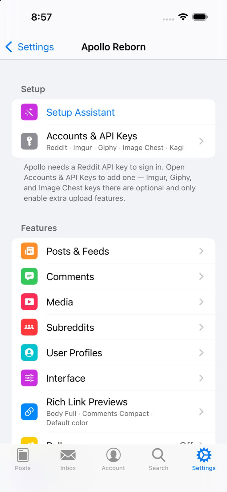
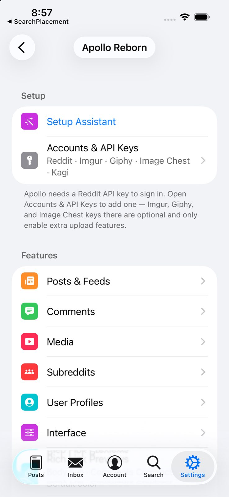

# Build 369 simulator evidence

Source `4a0bd01eeca784322d863a673254039e884d8bb1` passed full downstream validation and the SDK27.2 device package build. The code was unchanged for this evidence commit.

[Machine-readable matrix](simulator-summary.json) records four successful cold launches, iOS 26.5 and 27.0 in Classic and modern modes. Every launch explicitly injected the freshly built tweak, confirmed module initialization and actual appearance mode, opened the local Apollo Reborn settings screen, survived observation and produced no new Apollo crash report. The simulator used a separate bundle ID with no account backup.

| Classic, iOS 26.5 | Modern, iOS 26.5 |
| --- | --- |
|  |  |

Separate native UIKit harnesses executed the shipping search-placement function and snapshot helper with actual navigation items, search controllers and bar buttons: 120 checks on 26.5 and 126 on 27.0 passed. Foundation host suites pass 42 search restoration checks and 10 disabled-action dispatch checks. Six affected Duo host suites pass 443 checks.

Installed runtimes cannot emulate iPhone Duo. Actual folding, cover artwork, Focused tall images and finger-following animation remain pending supported-device acceptance. These network-free checks do not certify live Reddit, account-specific composer behavior or Bark delivery. Phone signing, installation and private data continuity are recorded separately outside Git.
