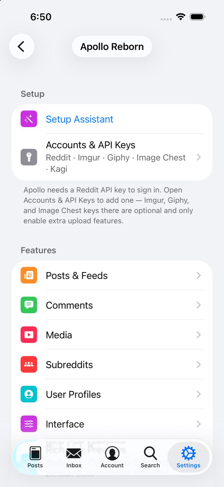
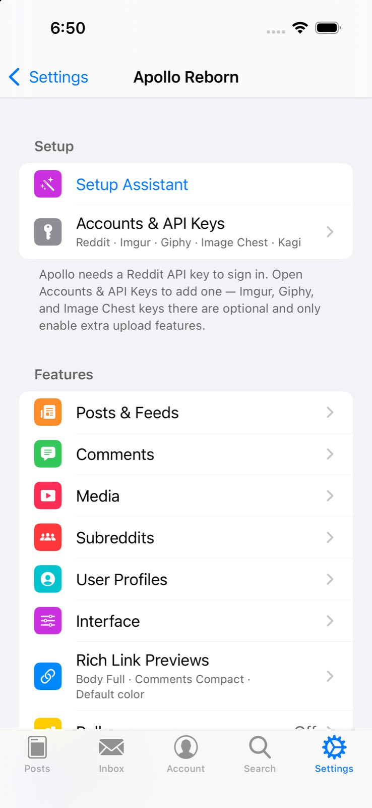
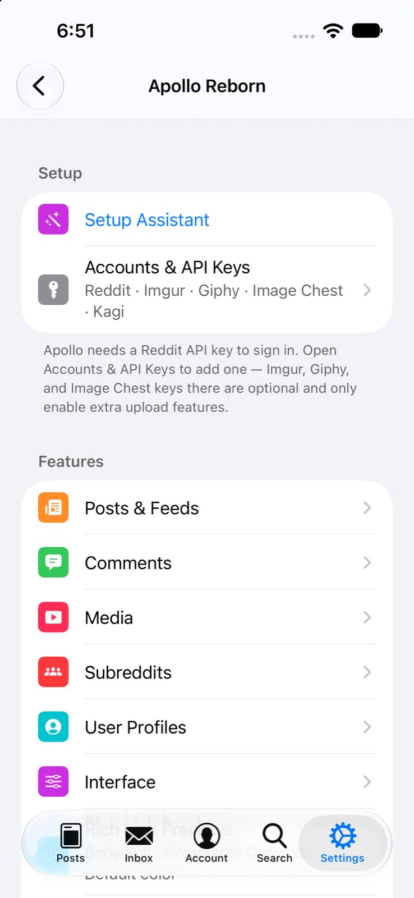
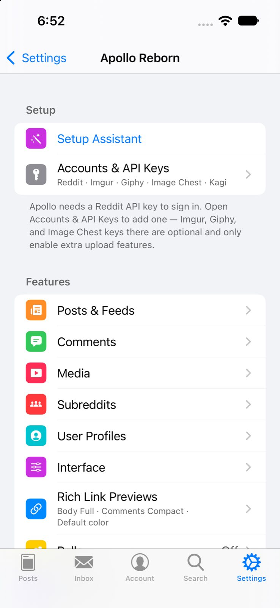
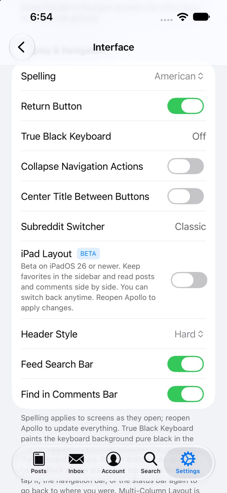

# Build 370 validation

Shipping source: `eb5430735ae0de9055056e132b8e67a06d4af8c7`. All 22 selected advertised upstream PR heads and upstream main `38679c6983e1ae3af6d6eeea31948ea34f8042c1` are included. #1592 is excluded to preserve Classic appearance and older-backup restoration.

## Automated

Full downstream validation, documentation health and the arm64 device package build pass with SDK 27.2 and an explicit iOS 15 deployment floor. The default release SDK26/iOS14 configuration is unchanged. Focused tests pass for All+, routes, spelling ASan/UBSan, native search visibility (428), direct actions (10), Duo thread cleanup (50) and Duo Back (145). Spelling regressions fail before the corrections and pass after them.

## Simulator visual

All four cold launches pass with the final freshly built simulator tweak explicitly injected: iOS26.5 and iOS27.0, each in Classic and modern modes. Logs confirm the requested mode, module initialization and local settings route. The processes survive observation and a delivered Back tap with no new Apollo crash reports. No account backup is loaded.

Fresh extracted-production search tests on real UIKit pass 225 assertions on iOS26.5 and 236 on iOS27.0. They exercise attachment, placement, temporary-Find cleanup and the dismissal delegate. Apollo feature bridges/header hooks and Duo predicates are synthetic. Initial harness failures came from main-queue starvation in the test runner; the corrected timer entry lets the unchanged production scheduler drain.

Compact screenshots were inspected for each root settings render. The Interface screen also shows Spelling and both search switches on. These screenshots establish rendered layout, not signed-in content or physical interaction acceptance.

| iOS | Modern | Classic |
| --- | --- | --- |
| 26.5 |  |  |
| 27.0 |  |  |

[Sanitized simulator evidence](simulator-summary.json)

## Physical device

Build370 is signed and archive-verified with the same bundle identity, seven extensions and eight valid profiles. The signed tweak UUID matches the final device package. Installation remains pending because the paired target iPhone is unavailable to the Mac. No uninstall or physical app mutation was performed.

Actual Duo fold/cover/rail gestures require supported hardware or a suitable runtime. Live Reddit/media/Bark workflows remain unverified. Daybreak was not run.
